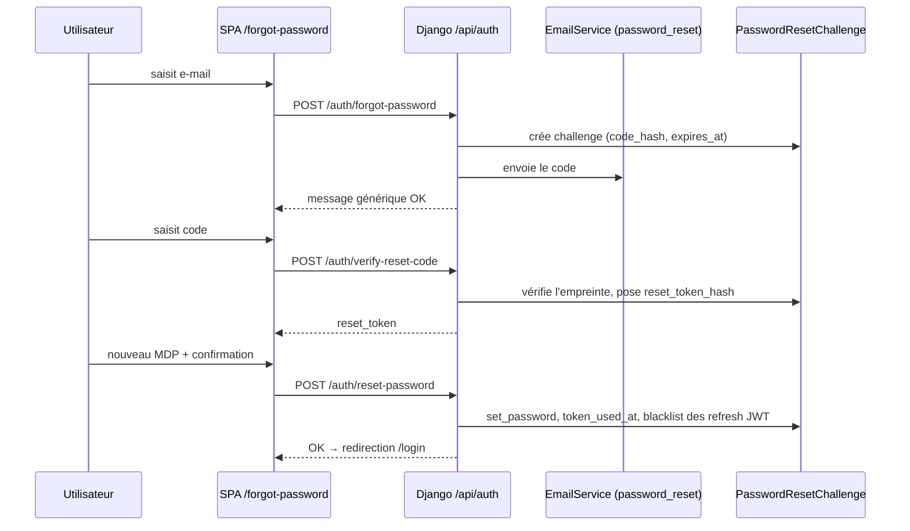

# Challenge de réinitialisation de mot de passe (forgot-password)

Ce document décrit le flux **« mot de passe oublié »** basé sur un **challenge** e-mail (code à 6 chiffres + token à usage unique). Le mot de passe de l'utilisateur n'est modifié qu'à la **dernière étape**.

> À ne pas confondre avec le **changement de mot de passe connecté** : `POST /api/auth/change-password` (utilisateur authentifié, dialogue « Mon compte »).
>
> Le **changement forcé à la première connexion** (`must_change_password`) n'est **pas implémenté**.

Lien utile : cookies / CSRF [`README_SAME_ORIGIN_COOKIES.md`](./README_SAME_ORIGIN_COOKIES.md).

---

## 1. Objectif

Parcours en 3 étapes :

1. Demande d'un **code** (e-mail).
2. Vérification du code → obtention d'un **`reset_token`** court.
3. Définition du **nouveau mot de passe** avec ce token.

Sécurité :

- Le code et le token ne sont **jamais stockés en clair** : seules leurs empreintes **HMAC-SHA256** (clé = `SECRET_KEY`) sont conservées et comparées en temps constant.
- Réponses **génériques** : aucune différence visible selon que le compte existe ou non (étapes 1 et 2).
- Tentatives de saisie du code limitées, et **limitation de débit par IP** sur les 3 routes.
- Après succès : **blacklist des refresh JWT** de l'utilisateur (toutes ses sessions sont fermées).

---

## 2. Flux (SPA)

Page publique : `/forgot-password`
Composant : `frontend/src/models/auth/components/forgot-password-form.tsx`
États UI : `email` → `code` → `password`.



---

## 3. Endpoints API

Tous en `AllowAny` (pas de JWT) ; l'en-tête `Authorization` est **ignoré** (un ancien token expiré ne provoque pas de 401). Préfixe : `/api/auth/...`.

| Étape | Méthode | Path | Body | Succès |
| --- | --- | --- | --- | --- |
| 1 | `POST` | `/auth/forgot-password` | `{ "email": "..." }` | `{ "message": "Si un compte est associé…" }` |
| 2 | `POST` | `/auth/verify-reset-code` | `{ "email", "code" }` | `{ "message", "reset_token" }` |
| 3 | `POST` | `/auth/reset-password` | `{ "reset_token", "new_password", "new_password_confirm" }` | `{ "message": "…mis à jour…" }` |

Erreurs :

- `400` avec `{ "error": "…" }` (validation, code/token invalide ou expiré, mot de passe refusé) ;
- `429` quand la limite de débit est atteinte.

Vues : `backend/app/core/views/auth_views.py` (`forgot_password_view`, `verify_reset_code_view`, `reset_password_view`)
Service : `backend/app/core/services/forgot_password_service.py`
URLs : `backend/app/core/urls.py`
Hooks RTK : `frontend/src/models/auth/api.ts` (`useForgotPasswordMutation`, `useVerifyResetCodeMutation`, `useConfirmPasswordResetMutation`).

Architecture : Vue → `ForgotPasswordService` → `PasswordResetChallengeRepository` / `UserRepository` → base (aucun appel ORM dans le service).

---

## 4. Modèle `PasswordResetChallenge`

Table : `core_password_reset_challenge`
Modèle : `backend/app/core/models.py`

| Champ | Rôle |
| --- | --- |
| `user` | FK utilisateur |
| `code_hash` | Empreinte HMAC du code e-mail |
| `expires_at` | Expiration du **code** |
| `attempts` | Tentatives de saisie du code |
| `code_used_at` | Code consommé (étape 2 OK) |
| `reset_token_hash` | Empreinte HMAC du token à usage unique (après l'étape 2), unique |
| `token_expires_at` | Expiration du **token** |
| `token_used_at` | Token consommé (étape 3 OK) |
| `created_at` | Création |

Admin Django : `PasswordResetChallengeAdmin` (lecture seule, empreintes masquées).

---

## 5. Constantes métier

Définies dans `forgot_password_service.py` :

| Constante | Valeur | Signification |
| --- | --- | --- |
| `CODE_LENGTH` | `6` | Chiffres uniquement |
| `CODE_TTL_MINUTES` | `15` | Durée de vie du code |
| `MAX_ATTEMPTS` | `5` | Essais max avant de devoir redemander un code |
| `RESET_TOKEN_TTL_MINUTES` | `10` | Durée de vie du `reset_token` après vérification |
| `RESEND_COOLDOWN_SECONDS` | `60` | Délai minimal entre deux demandes pour un même compte |

Règles à l'étape 3 :

- `new_password` === `new_password_confirm` ;
- longueur minimale **8** caractères ;
- validateurs Django (`AUTH_PASSWORD_VALIDATORS` : mot de passe trop courant, 100 % numérique, trop proche des infos du compte…). Un mot de passe refusé **ne consomme pas** le token : l'utilisateur peut corriger.

Limitation de débit par IP (constantes de `REST_FRAMEWORK['DEFAULT_THROTTLE_RATES']` dans `config/settings.py`) :

| Route | Taux |
| --- | --- |
| `forgot-password` | `5/hour` |
| `verify-reset-code` | `20/hour` |
| `reset-password` | `10/hour` |

--- | --- | --- |
| `forgot-password` | `PASSWORD_RESET_REQUEST_RATE` | `5/hour` |
| `verify-reset-code` | `PASSWORD_RESET_VERIFY_RATE` | `20/hour` |
| `reset-password` | `PASSWORD_RESET_CONFIRM_RATE` | `10/hour` |

---

## 6. Comportement détaillé

### Étape 1 — `request_password_reset`

- E-mail normalisé (`lower().strip()`), recherche insensible à la casse.
- Compte inexistant ou inactif → **même réponse générique**, sans e-mail.
- Demande trop rapprochée (moins de 60 s après la précédente) → même réponse générique, sans nouvel e-mail.
- Les challenges encore ouverts du compte sont invalidés, puis un nouveau est créé et le code est envoyé.
- **Échec d'envoi** (SMTP, gabarit) : la transaction est annulée (les codes précédents restent valides), l'erreur est journalisée **sans le code**, et la réponse reste **générique** (une erreur explicite révélerait que le compte existe).

### Étape 2 — `verify_reset_code`

- Dernier challenge ouvert du compte (`code_used_at` et `token_used_at` nuls), verrouillé pendant la vérification.
- **Un seul message** pour tous les échecs (compte inconnu, code faux, code expiré, trop d'essais) : « Code invalide ou expiré. Redemandez un code si nécessaire. » — pas de décompte des tentatives restantes, qui révélerait l'existence du compte.
- Mauvais code → `attempts += 1` (conservé même si la requête échoue). À 5 échecs, même le bon code est refusé : il faut redemander un code.
- Bon code → `code_used_at`, génération du `reset_token` (`secrets.token_urlsafe(32)`), stockage de son empreinte, `token_expires_at` = maintenant + 10 min.
- Le `reset_token` **en clair** n'est renvoyé qu'une fois (gardé en mémoire dans la SPA jusqu'à l'étape 3).

### Étape 3 — `confirm_password_reset`

- Recherche par empreinte du token : non utilisé, non expiré, compte actif.
- `set_password`, `token_used_at`, invalidation des autres challenges ouverts.
- Blacklist de tous les refresh JWT de l'utilisateur (`OutstandingToken` → `BlacklistedToken`).
- L'utilisateur doit **se reconnecter** (aucune session créée ici).

---

## 7. E-mail

Envoi par `backend/app/core/services/email_service.py` (e-mail multipart texte + HTML).
Gabarits : `backend/app/core/templates/core/emails/password_reset.txt` et `password_reset.html`.

Variables de contexte :

| Variable | Contenu |
| --- | --- |
| `{{ first_name }}` | Prénom (ou nom d'utilisateur) |
| `{{ reset_code }}` | Code à 6 chiffres |
| `{{ code_ttl_minutes }}` | Durée de validité du code (15) |
| `{{ login_url }}` | `FRONTEND_URL` + `/login` |

Configuration (`backend/.env`, voir `.env.example`) : ces variables sont obligatoires, sans valeur de repli.

| Variable | Rôle |
| --- | --- |
| `EMAIL_BACKEND` | `django.core.mail.backends.console.EmailBackend` (développement : e-mails affichés dans la console du serveur) ou `django.core.mail.backends.smtp.EmailBackend` (production) |
| `EMAIL_HOST`, `EMAIL_HOST_USER`, `EMAIL_HOST_PASSWORD` | Serveur SMTP : obligatoires seulement avec le moteur SMTP (port 587 et TLS sont des constantes) |
| `DEFAULT_FROM_EMAIL` | Expéditeur |
| `FRONTEND_URL` | URL publique du frontend (lien de connexion) |

--- | --- |
| `EMAIL_HOST` | Serveur SMTP. **Vide = les e-mails s'affichent dans la console du serveur** (développement) |
| `EMAIL_PORT`, `EMAIL_HOST_USER`, `EMAIL_HOST_PASSWORD`, `EMAIL_USE_TLS` | Paramètres SMTP |
| `EMAIL_BACKEND` | Surcharge du moteur d'envoi (par défaut : SMTP si `EMAIL_HOST` est défini, sinon console) |
| `DEFAULT_FROM_EMAIL` | Expéditeur |
| `FRONTEND_URL` | URL publique du frontend (lien de connexion) |

---

## 8. Front — points d'attention

- Route publique `/forgot-password` (dans `PublicRoute`, hors `PrivateRoute`), mise en page commune avec la connexion (`auth-layout.tsx`).
- Lien « Mot de passe oublié ? » sous le formulaire de connexion.
- Le `reset_token` reste en state React entre les étapes 2 et 3 (jamais dans l'URL ni dans le stockage du navigateur) ; recharger la page ramène à l'étape 1.
- Bouton « Renvoyer le code » avec compte à rebours de 60 s (aligné sur `RESEND_COOLDOWN_SECONDS`).
- Après succès à l'étape 3 : message de confirmation puis navigation vers `/login`.
- `/forgot-password` n'est **jamais** mémorisée comme « page à rouvrir après connexion » (voir `PUBLIC_AUTH_PATHS` dans `models/auth/functions/redirect-after-login.ts`).

CSRF / cookies same-origin : ces endpoints sont publics ; voir le README cookies.

---

## 9. Changement de MDP authentifié (hors challenge)

| | Forgot-password (challenge) | Change password (connecté) |
| --- | --- | --- |
| Auth | Non | Oui (`IsAuthenticated`) |
| Endpoint | `/auth/forgot-password` → … → `/auth/reset-password` | `/auth/change-password` |
| Preuve | Code e-mail + token | Ancien mot de passe |
| UI | `/forgot-password` | Dialogue Mon compte |

---

## 10. Dépannage

| Symptôme | Piste |
| --- | --- |
| Réponse générique mais pas d'e-mail | Compte inexistant / inactif, demande à moins de 60 s de la précédente, SMTP mal configuré (voir les logs du serveur : « Échec de l'envoi du code… »). En développement sans `EMAIL_HOST`, l'e-mail est dans la console du serveur |
| « Code invalide ou expiré » | Code expiré (15 min), mauvais e-mail, code remplacé par une nouvelle demande, ou 5 essais déjà utilisés → redemander un code |
| « Session de réinitialisation invalide ou expirée » à l'étape 3 | Token expiré (10 min), déjà utilisé, ou page rechargée (token perdu en mémoire) |
| Erreur 429 | Limite de débit par IP atteinte (voir §5) ; le cache par défaut est local à chaque processus |
| Connexion refusée après reset | Normal : se reconnecter ; les anciennes sessions sont invalidées |
| `relation "core_password_reset_challenge" does not exist` | Migration non appliquée : `python manage.py migrate` |

Vérif SQL rapide (Postgres) :

```sql
SELECT id, user_id, attempts, expires_at, code_used_at,
       token_expires_at, token_used_at, created_at
FROM core_password_reset_challenge
ORDER BY created_at DESC
LIMIT 20;
```

Purge des anciens challenges (à planifier, par exemple chaque jour) :

```bash
python manage.py purge_password_reset_challenges --days 7
```

---

## 11. Fichiers clés

| Rôle | Chemin |
| --- | --- |
| Modèle | `backend/app/core/models.py` (`PasswordResetChallenge`) |
| Migration | `backend/app/core/migrations/0002_passwordresetchallenge.py` |
| Interface / dépôt | `backend/app/core/interfaces/password_reset_challenge_repository_interface.py`, `backend/app/core/repositories/password_reset_challenge_repository.py` |
| Service | `backend/app/core/services/forgot_password_service.py` |
| Envoi d'e-mail | `backend/app/core/services/email_service.py` + `backend/app/core/templates/core/emails/` |
| Limitation de débit | `backend/app/core/throttles.py` |
| Vues API / URLs | `backend/app/core/views/auth_views.py`, `backend/app/core/urls.py` |
| Commande de purge | `backend/app/core/management/commands/purge_password_reset_challenges.py` |
| Tests backend | `backend/app/tests/test_password_reset.py` |
| Page SPA | `frontend/src/models/auth/pages/forgot-password-page.tsx` |
| Formulaire | `frontend/src/models/auth/components/forgot-password-form.tsx` |
| Mise en page | `frontend/src/models/auth/components/auth-layout.tsx` |
| API client / schémas | `frontend/src/models/auth/api.ts`, `frontend/src/models/auth/schema.ts` |

---

## 12. Règles à respecter

1. **Ne jamais** journaliser le code ou le `reset_token` en clair.
2. **Ne jamais** renvoyer un message ou un statut différent selon « e-mail connu / inconnu » (étapes 1 et 2), y compris en cas d'échec d'envoi.
3. Toute évolution du TTL ou de la longueur du code : aligner le service **et** le gabarit e-mail (`{{ code_ttl_minutes }}`), ainsi que le schéma Zod du front (6 chiffres).
4. Le mot de passe n'est écrit qu'à l'étape 3 (`confirm_password_reset`).
5. Après un reset réussi, l'utilisateur passe par `/login` (pas de session automatique).
6. En production : configurer un vrai SMTP, `FRONTEND_URL`, et un cache partagé (Redis, par exemple) pour que la limitation de débit soit commune à tous les processus.
