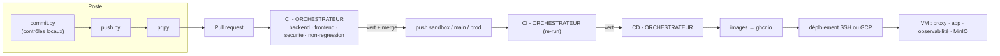
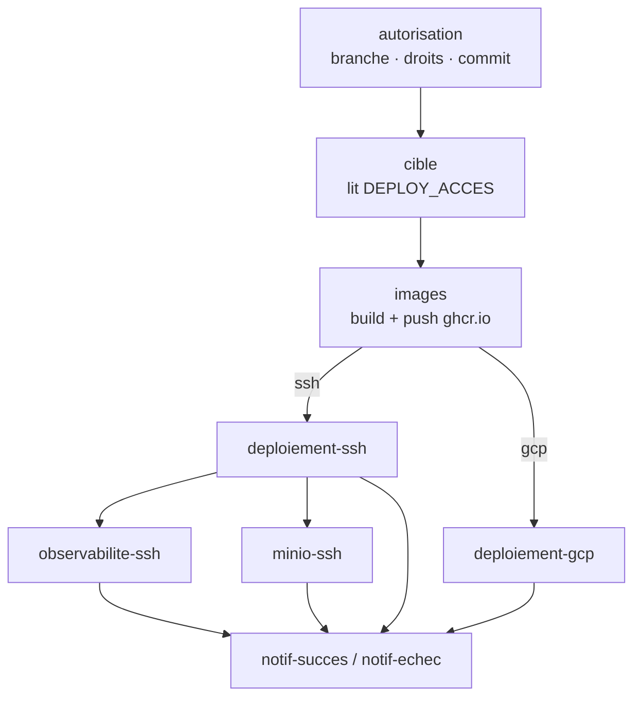

# Pipeline CI/CD de devstreet : vue d'ensemble

Ce document explique **comment tout s'enchaîne**, du `git commit` sur le poste jusqu'au site en ligne sur la VM, et recense tout ce que nous avons automatisé. C'est la porte d'entrée : chaque section renvoie vers le guide détaillé quand il existe.

> Dernière relecture contre le code : 2026-11-15 (workflows de `.github/workflows/`, `git-cli/`, `deploy/`, `backend/scripts/`). En cas de divergence avec une autre doc, **le code fait foi** (voir [§13](#13-écarts-connus-entre-les-docs-et-le-code)).

## Sommaire

1. [En une image](#1-en-une-image)
2. [Branches, environnements et promotion](#2-branches-environnements-et-promotion)
3. [Couche 1 : le poste (git-cli et hooks)](#3-couche-1--le-poste-git-cli-et-hooks)
4. [Couche 2 : le contrôle GitHub de git-cli](#4-couche-2--le-contrôle-github-de-git-cli)
5. [Couche 3 : l'intégration continue (CI)](#5-couche-3--lintégration-continue-ci)
6. [Couche 4 : le déploiement continu (CD)](#6-couche-4--le-déploiement-continu-cd)
7. [Environnements GitHub, variables et secrets](#7-environnements-github-variables-et-secrets)
8. [Ce qui tourne sur la VM](#8-ce-qui-tourne-sur-la-vm)
9. [Workflows manuels (vérification, build, maintenance, stacks annexes)](#9-workflows-manuels)
10. [Notifications Slack / Teams](#10-notifications-slack--teams)
11. [Garde-fous de sécurité de la chaîne](#11-garde-fous-de-sécurité-de-la-chaîne)
12. [Recettes : que faire quand…](#12-recettes--que-faire-quand)
13. [Écarts connus entre les docs et le code](#13-écarts-connus-entre-les-docs-et-le-code)
14. [Limites assumées](#14-limites-assumées)
15. [Où se trouve quoi](#15-où-se-trouve-quoi)

---

## 1. En une image



Les quatre couches, de la plus proche du développeur à la plus proche de la production :

| Couche | Où | Ce qu'elle garantit |
|---|---|---|
| 1. Poste | `git-cli/` + `.githooks/` | Pas de `git commit` / `git push` direct, trailer obligatoire, chemins protégés réservés aux masters, contrôles qualité avant commit |
| 2. Contrôle GitHub de git-cli | `git-cli-enforce-*.yml` | Mêmes règles revérifiées côté serveur (on ne fait pas confiance au poste), flux de branches, marqueur de PR |
| 3. CI | `ci-*.yml` | Migrations saines, lint/tests/build du frontend, scanner de sécurité, non-régression des zones sensibles |
| 4. CD | `cd-*.yml` + `deploy/` | Images construites une fois, déploiement idempotent sur la VM de la branche, contrôle de santé de bout en bout |

Principes qui traversent toute la chaîne :

- **Une CI rouge ne déploie rien.** Une pull request ne déploie jamais.
- **Une branche = un environnement = une VM possible.** Les secrets d'un environnement ne sont lisibles que depuis sa branche.
- **Une image est construite une seule fois** (tag = SHA) puis réutilisée, y compris pour un retour arrière.
- **Aucun secret réel en CI** : les secrets de test sont générés à chaque exécution.
- **Tout est rejouable à la main** : chaque workflow se lance seul depuis l'onglet Actions (*Run workflow*).

---

## 2. Branches, environnements et promotion

| Branche | Environnement GitHub | Déployée ? | Rôle |
|---|---|---|---|
| branches de travail (`<prenom>-feat-<sujet>`) | aucun | non | Développement |
| `develop` | aucun | **jamais** | Intégration |
| `sandbox` | `sandbox` | oui | Bac à sable déployé (fil conducteur du runbook `deploy/README.md`) |
| `main` | `main` (staging) | oui | Pré-production |
| `prod` | `prod` | oui | Production |

```text
ta branche → PR → develop            (intégration, jamais déployée)
develop → PR → sandbox               (déploie sandbox)
develop → PR → main → PR → prod      (déploie staging, puis production)
```

Règles de flux imposées par `git-cli-enforce-pr.yml` :

- PR vers `main` : `head` doit être `develop` ;
- PR vers `prod` : `head` doit être `main` ;
- PR vers `develop` : `head` ne peut pas être `develop`, `main` ni `prod` ;
- toute autre base (dont `sandbox`) : **aucune règle de flux** (voir [§13](#13-écarts-connus-entre-les-docs-et-le-code)).

Les branches déployées sont figées à trois endroits qui doivent rester alignés : le déclencheur `push` de `ci-orchestrateur.yml`, la liste `case … sandbox|main|prod` des workflows `cd-*`, et `BRANCHES` dans `backend/scripts/deploy_env/spec.py`.

---

## 3. Couche 1 : le poste (git-cli et hooks)

Mise en place une fois : `python git-cli/install-hooks.py` (règle `core.hooksPath=.githooks`), puis `python git-cli/doctor.py` pour diagnostiquer.

### Hooks (`.githooks/`)

| Hook | Refuse si… |
|---|---|
| `commit-msg` | le message n'a pas le trailer `X-Git-CLI: doonya-git-cli/2.0` (la `1.0` reste acceptée en transition) ; ou l'e-mail du commiteur n'est pas dans `GIT_MASTER_EMAILS` **et** un fichier de `PROTECTED_PATHS` est stagé |
| `pre-push` | `DOONYA_GITCLI_PUSH` n'est pas à `1` (donc `git push` direct) ; ou la cible est une branche de `IDENTITY_RESTRICTED_BRANCHES` (`main`, `develop`, `prod`) et l'e-mail n'est pas dans `GIT_MASTER_EMAILS` |

### Scripts (`git-cli/`)

| Script | Rôle |
|---|---|
| `commit.py` | Contrôles locaux → audit des zones → staging → message Conventional Commits → commit avec trailer |
| `push.py` | Pose `DOONYA_GITCLI_PUSH=1` puis pousse (le build frontend est vérifié par la CI, pas ici) |
| `pr.py` | Crée la PR (marqueur `<!-- X-Git-CLI-PR: doonya-git-cli/2.0 -->`, titre `pr-<type>(<scope>): <titre>`), synchronise la branche, refuse s'il n'y a rien à merger. `--base` force la cible |
| `pull.py` / `rebase.py` / `merge.py` | `pull --rebase` strict ; rebase sur `origin/develop` ; merge vers `develop` avec assistant de conflits |
| `check_zones.py` | Audit des zones protégées (motifs orphelins, fichiers hors zone) |
| `deploy_env.py` | Variables/secrets d'un environnement, préparation de VM, tunnel local (masters, [§7](#7-environnements-github-variables-et-secrets)) |
| `doctor.py` | Diagnostic de l'installation |

### Contrôles lancés par `commit.py` (`quality_checks.py`)

Avant tout `git add` : **sécurité** (scanner, comme en CI), **migrations backend**, **lint frontend**. Un échec ouvre un menu (relancer / quitter) et rien n'est stagé. Les tests et le build frontend restent réservés à la CI. Ensuite, l'audit des zones avertit (sans bloquer) des motifs orphelins.

### Qui a quels droits (`git-cli/access_control.conf`)

| Clé | Sert à |
|---|---|
| `GIT_MASTER_EMAILS` | Poster sur les branches protégées et toucher aux `PROTECTED_PATHS` (contrôle **local** et CI par e-mail d'auteur) |
| `GIT_MASTER_USERS` | Idem côté GitHub (acteur du push) **et** droit de lancer à la main les workflows CD et de maintenance |
| `ZONE_PROTEGEE_USERS` | Responsables des zones protégées : seuls à pouvoir valider une PR qui en touche une |
| `IDENTITY_RESTRICTED_BRANCHES` | Branches réservées aux masters en push (`main,develop,prod`) |
| `PROTECTED_PATHS` | `.github/workflows/`, `.githooks/`, `git-cli/`, `00conventions/`, `deploy/`, `backend/scripts/deploy_env/` |

> Les workflows CD relisent `GIT_MASTER_USERS` dans **`origin/develop`** (`git show origin/develop:git-cli/access_control.conf`) : une branche de travail ne peut donc pas s'ajouter elle-même à la liste.

---

## 4. Couche 2 : le contrôle GitHub de git-cli

Le poste peut être contourné (hooks désactivés, autre machine). GitHub rejoue donc les règles :

| Workflow | Déclenché sur | Contrôle |
|---|---|---|
| `git-cli-enforce-pr` | PR (ouverte, éditée, nouveau push, rouverte) | Flux de branches ([§2](#2-branches-environnements-et-promotion)) + présence du marqueur `X-Git-CLI-PR` dans le corps de la PR |
| `git-cli-enforce-push-non-protege` | push sur toute branche **sauf** `main`, `develop`, `prod` | Trailer `X-Git-CLI` sur chaque nouveau commit ; auteur des commits touchant un chemin protégé dans `GIT_MASTER_EMAILS` |
| `git-cli-enforce-push-protege` | push sur `main`, `develop`, `prod` | L'acteur GitHub (`github.actor`) est dans `GIT_MASTER_USERS` |

Sans rulesets GitHub (plan Free), ces contrôles **échouent visiblement mais ne bloquent pas techniquement** le merge : il faut activer la protection de branche pour les rendre contraignants (voir [§5.6](#56-rendre-les-contrôles-obligatoires)).

---

## 5. Couche 3 : l'intégration continue (CI)

### 5.1 Le chef d'orchestre : `CI - ORCHESTRATEUR`

Fichier : `.github/workflows/ci-orchestrateur.yml`. Il appelle quatre workflows réutilisables, en parallèle.

| Déclencheur | Ce qui se passe |
|---|---|
| `pull_request` (toute base) | Les 4 contrôles + notification (secrets **de dépôt**) |
| `pull_request_review` (soumise / rejetée) | Relance l'orchestrateur pour que la non-régression **revoie l'approbation** d'un responsable (pas de notification) |
| `push` sur `sandbox`, `main`, `prod` | Les 4 contrôles ; si tout est vert, job `deploiement` → CD ([§6](#6-couche-4--le-déploiement-continu-cd)) |
| `workflow_dispatch` | `backend`, `frontend`, `securite` seulement (la non-régression se lance directement dans son workflow) |

Points de fonctionnement :

- **Concurrence** : groupe `ci-<n° de PR ou ref>` ; un nouveau push **annule** la CI en cours **uniquement sur une PR** (sur une branche déployée, les CI ne s'annulent pas : voir la garde « pointe de branche » du CD).
- **Un push sur `develop` ne lance pas la CI** : le code y est entré par une PR déjà contrôlée.
- Permissions minimales (`contents: read`), élargies job par job (`pull-requests: write` pour la non-régression, `packages: write` + `id-token: write` pour le déploiement).
- Les actions GitHub sont **épinglées par SHA de commit**, pas par étiquette.

### 5.2 `CI - BACKEND` (timeout 20 min)

Sur Python 3.12 avec un **PostgreSQL 16 jetable** (`postgres:16-alpine`, sans mot de passe, détruit avec le job). Les variables (`SECRET_KEY`, `JWT_SIGNING_KEY`, `DB_PASSWORD`, `ADMIN_PASSWORD`…) sont **générées aléatoirement** à chaque run.

| Étape | Commande | Échoue si… |
|---|---|---|
| Conflit de migrations | `makemigrations --merge --dry-run --noinput` | la sortie ne contient pas « No conflicts detected to merge. » : deux migrations partent de la même base → `python manage.py makemigrations --merge` en local, commiter la fusion |
| Migration manquante | `makemigrations --check --dry-run` | un modèle a changé sans migration |

> **Les tests Django ne tournent plus en CI** (retirés le 2026-11-13, journal n° 20 : suite pas encore fiable). `python manage.py test` reste utilisable en local. À remettre quand la suite sera fiable.

### 5.3 `CI - FRONTEND` (timeout 20 min)

Node 20, dans l'ordre : `npm ci` → `npm run lint` → `npm test` (Vitest) → `npm run build` (`tsc -b` + Vite) avec `VITE_API_URL=/api` et `VITE_API_V1_URL=/api/v1`. Le lint est bloquant sur tout le code, sauf deux règles désactivées pour les composants shadcn générés (`src/components/ui`, `use-toast.ts`, dans `eslint.config.js`).

### 5.4 `CI - SECURITE` (timeout 10 min), job `scanner`

`python -m scripts.security_scan --fail-on warning` depuis `backend/` : **43 règles** déterministes (familles `SEC`, `DJ`, `PY`, `FE`, `DOCKER`, `DEP`, `CFG`, `FB`, `RT`, `API`, `SUP`), score de 0 à 100. Échec dès qu'un problème de niveau avertissement ou plus n'est pas couvert par une **exception datée**.

- Exceptions dans `security-exceptions.json` : règle + **fichier précis** + raison (≥ 15 caractères) + auteur + expiration (**180 jours maximum**). Une exception expirée ne protège plus ; une exception inutilisée est signalée.
- Catalogue des règles : [`README_SECURITY_RULES.md`](./README_SECURITY_RULES.md). Détail de l'outil : `backend/scripts/security_scan/README.md`.
- **L'audit des dépendances** (`pip-audit`, `npm audit`) est **retiré de la CI** pour le moment ; l'outil `backend/scripts/dependency_audit` reste dans le dépôt. La règle `SUP-001` est couverte par deux exceptions datées, à retirer quand l'audit reviendra.

### 5.5 `CI - NON-REGRESSION` (timeout 10 min)

Principe : certains fichiers sont **sensibles** (auth, configuration, permissions, migrations, générateur, scanner, chaîne de livraison, le garde lui-même). Les modifier n'est **jamais interdit**, mais c'est **signalé** et soumis à la validation d'un responsable.

`regression-guard.json` décrit les zones :

| Zone | Protège |
|---|---|
| `auth-cookies` | Connexion, cookies HttpOnly, JWT, CSRF, verrouillage, journal d'audit |
| `config-securite` | `backend/config/**`, `.env.example`, middleware, `entrypoint.sh` |
| `permissions-roles` | Modèles, permissions, services et dépôts du `core` |
| `migrations` | `backend/app/*/migrations/**` |
| `generateur` | Générateur CRUD et ses templates |
| `scanner-securite` | Scanner, audit des dépendances et leurs exceptions |
| `deploiement-ci` | `.github/**`, `.githooks/**`, `git-cli/**`, `deploy/**`, `deploy_env`, Dockerfile et nginx du frontend |
| `regression-guard` | Le contrôle lui-même |

Chaque zone porte : `name`, `reason`, `paths` (`*` dans un dossier, `**` traverse, `/` final = dossier entier), `tests` (un test modifié ne déclenche pas la zone ; un test **supprimé** la déclenche), `verify` (consigne affichée) et `owners` (facultatif).

**Sur une pull request** le workflow :

1. compare la PR à sa branche cible (depuis l'ancêtre commun) ;
2. pose **un seul commentaire** (mis à jour à chaque push) et le label `zone-protegee` ;
3. **échoue** tant que ni l'auteur de la PR n'est dans `ZONE_PROTEGEE_USERS`, ni un membre de `ZONE_PROTEGEE_USERS` n'a **approuvé le dernier commit** (un nouveau push annule l'approbation).

Anti-contournement : les règles **et l'outil** sont lus sur la **branche cible** (`trusted/`), donc une PR ne peut pas réécrire `regression-guard.json` pour se rendre invisible (sauf à l'introduction initiale). Les PR de forks n'ont ni commentaire ni label, mais échouent de la même façon.

**Sur un push** (`sandbox`/`main`/`prod`) ou en manuel (comparer par exemple `main` et `prod` avant une mise en production), le résultat va dans le résumé du job **sans bloquer**.

Codes de sortie de l'outil : `0` aucune zone touchée, `1` au moins une, `2` configuration invalide (**bloquant**, y compris un motif qui ne correspond à aucun fichier). En local :

```powershell
cd backend
python -m scripts.regression_guard --base origin/develop
python -m scripts.regression_guard --audit        # ou : python git-cli/check_zones.py
```

> À ne pas confondre : `PROTECTED_PATHS` (git-cli) limite **qui** peut modifier un chemin ; la non-régression signale **que** des fichiers sensibles ont changé, pour tout le monde, masters compris.

### 5.6 Rendre les contrôles obligatoires

À régler **une fois** dans GitHub (Settings > Branches ou Rulesets, pour `develop`, `main`, `prod` et `sandbox`) : *Require status checks to pass before merging*, en choisissant `backend`, `frontend`, `securite` (job `scanner`) et `non-regression`. Un contrôle n'est sélectionnable qu'après s'être exécuté au moins une fois. Ce réglage vit dans GitHub : **il n'est pas vérifiable depuis le dépôt**.

---

## 6. Couche 4 : le déploiement continu (CD)

### 6.1 Déclenchement

- **Automatique** : un push/merge vers `sandbox`, `main` ou `prod` → `CI - ORCHESTRATEUR` → si les 4 contrôles sont verts, le job `deploiement` appelle `CD - ORCHESTRATEUR` **sur la branche poussée** (c'est ce qui lui donne accès à l'environnement du même nom).
- **Manuel** (relance, retour arrière) : *Actions > CD - ORCHESTRATEUR > Run workflow*, « Use workflow from » = la branche, champ `sha` facultatif (40 caractères ; vide = dernier commit). Réservé à `GIT_MASTER_USERS`.

### 6.2 Les jobs de `CD - ORCHESTRATEUR`



| Job | Rôle | Détails |
|---|---|---|
| `autorisation` | Valide la branche (`sandbox`/`main`/`prod`), l'auteur (manuel) et le commit | **Garde « pointe de branche »** : sur un push, le commit doit encore être la pointe de la branche (API GitHub). Sinon `deployer=false` : le déploiement est ignoré (un commit plus récent le remplace ; pas de retour arrière silencieux). Le `sha` doit faire 40 caractères hexadécimaux |
| `cible` | Lit `DEPLOY_ACCES` dans l'environnement de la branche | `ssh` ou `gcp`, sinon erreur |
| `images` | Appelle `cd-build-images.yml` | [§6.3](#63-construction-des-images-cd---build-images) |
| `deploiement-ssh` / `deploiement-gcp` | Appelle `cd-deploiement-ssh.yml` ou `-gcp.yml` | [§6.4](#64-déploiement-sur-la-vm) |
| `observabilite-ssh` | Grafana/Prometheus/Loki | SSH uniquement, **bloquant**, après un déploiement réussi |
| `minio-ssh` | MinIO (S3) | SSH uniquement, **bloquant**, après un déploiement réussi |
| `notif-succes` / `notif-echec` | Slack / Teams | [§10](#10-notifications-slack--teams) |

**Concurrence** : `cd-<branche>` sans annulation (un déploiement en cours n'est **jamais** interrompu ; deux déploiements d'une même branche s'enchaînent). Le déploiement lui-même, l'observabilité, MinIO et toute la maintenance partagent le groupe `cd-deploiement-<branche>` : pas de maintenance pendant un déploiement, et inversement.

### 6.3 Construction des images (`CD - BUILD IMAGES`)

Publie sur `ghcr.io/<organisation>/<dépôt>-backend` et `-frontend` :

| Image | Tag | Pourquoi |
|---|---|---|
| backend | `<sha>` | Identique pour tous les environnements |
| frontend | `<branche>-<sha>-<empreinte 8 car.>` | L'empreinte couvre `VITE_API_URL`, `VITE_API_V1_URL` et `VITE_USE_S3`, **figées dans le JavaScript** à la construction : changer un `VITE_*` donne un nouveau tag pour le même commit |

- **Pas de reconstruction** si le tag existe déjà (`docker manifest inspect`) : un retour arrière ne coûte aucune construction.
- Le commit doit appartenir à l'historique de la branche (`merge-base --is-ancestor`) : impossible de publier pour `prod` un commit absent de `prod`.
- `VITE_API_URL` et `VITE_API_V1_URL` doivent exister dans l'environnement de la branche.
- Build avec `--provenance=false --sbom=false` : sans cela GHCR refuse parfois le manifeste final (`denied`) après avoir reçu les calques (journal n° 5).
- Connexion au registre par le jeton du job (valable le temps de l'exécution), déconnexion `if: always()`. Paquets privés, rattachés au dépôt.
- Lancement manuel possible pour construire sans déployer (masters).

### 6.4 Déploiement sur la VM

Deux transports, **mêmes scripts sur la VM** (`deploy/vm/*.sh`). Choix par la variable `DEPLOY_ACCES` de l'environnement : une branche peut rester en `ssh` pendant qu'une autre passe en `gcp`.

**Mode `ssh`** (`cd-deploiement-ssh.yml`, timeout 30 min), dans l'ordre :

1. Récupère le commit exact (`ref: <sha>`).
2. **Rend** `backend.env` et `compose.env` depuis les variables/secrets de l'environnement (`python -m scripts.deploy_env.render`). Le rendu **refuse** : valeur manquante, apostrophe ou retour à la ligne dans une valeur, `DB_HOST` ≠ `db` en mode `interne`, `DEPLOY_DOMAIN` absent de `ALLOWED_HOSTS` (Django refuserait le contrôle de santé).
3. Prépare la clé SSH (`VM_SSH_PRIVATE_KEY`) et l'empreinte épinglée (`VM_SSH_KNOWN_HOSTS`), en `StrictHostKeyChecking=yes`, `ed25519` seulement.
4. Envoie `deploy/` puis les deux fichiers (droits 600) dans `/opt/apps/<namespace>/`.
5. Exécute `deploy/vm/deployer.sh` sur la VM ; le jeton du registre transite par **stdin** et n'est jamais écrit sur le disque.
6. **Contrôle de bout en bout depuis le runner** : `https://<domaine>/api/health` et `https://<domaine>/` (6 tentatives, 10 s d'écart).
7. Supprime clé SSH et fichiers rendus (`if: always()`).

**Mode `gcp`** (`cd-deploiement-gcp.yml`, `deploy/ci/gcp-vm.sh`) : VM **sans IP publique**, accès par **tunnel IAP** (`gcloud compute ssh --tunnel-through-iap`), authentification par **Workload Identity Federation** (aucune clé ni secret SSH dans GitHub). Le compte de service n'est autorisé que pour l'environnement de la branche. Prérequis IAM détaillés : [`README_CD.md`](./README_CD.md) §7.

**Ce que fait `deployer.sh`** (sur la VM, par l'utilisateur `deploy`) :

| # | Étape | Détail |
|---|---|---|
| 1 | Validation | `DEPLOY_NAMESPACE` et `DEPLOY_DOMAIN` revalidés, dossier de travail contrôlé |
| 2 | **Verrou** | `flock` sur `/opt/apps/.deployer.lock` : un seul déploiement à la fois sur la VM, attente max **20 min** (le proxy et la session du registre sont partagés) |
| 3 | Registre | `docker login ghcr.io` (jeton lu sur stdin) |
| 4 | Place disque | Étend `/` si le disque a grandi (`doonya-grow-rootfs`), nettoie les anciennes images (`cleanup-docker.sh`, **jamais les volumes**), exige **≥ 2 Go** libres |
| 5 | Images | `compose pull` |
| 6 | Proxy partagé | Copie `compose.yml`/`nginx.conf` dans `/opt/apps/_proxy`, `up -d` |
| 7 | Dossiers publics | `/srv/public/<namespace>/{static,media}`, propriétaire uid 10001 (utilisateur de l'image backend) |
| 8 | **Certificat HTTPS** | Si absent : site HTTP seul → `certbot certonly --webroot` (Let's Encrypt, HTTP-01) ; sinon réutilisé |
| 9 | Application | `compose up -d --wait --wait-timeout 300 --remove-orphans` (migrations au démarrage du conteneur) |
| 10 | Site HTTPS | Génère le site depuis le gabarit, `nginx -t`, **restaure l'ancienne configuration si refusée**, puis `nginx -s reload` |
| 11 | Trace | Écrit le SHA dans `deploiement-actuel`, nettoyage final |

En cas d'échec, le script affiche l'état et les 80 dernières lignes de journaux avant de sortir en erreur.

### 6.5 Retour arrière

Manuel seulement : relancer **CD - ORCHESTRATEUR** avec le SHA d'une version précédente. Les images existent déjà, rien n'est reconstruit. ⚠️ **Les migrations déjà appliquées ne sont pas annulées** : vérifier avant que l'ancienne image reste compatible avec le schéma (règle de développement : ajouter avant de supprimer).

---

## 7. Environnements GitHub, variables et secrets

### Principe

Chaque branche déployée a un **environnement GitHub du même nom**, **réservé à cette branche** (*Deployment branches and tags* : la seule branche `<nom>`). Variables et secrets y sont stockés sous leur **nom simple** (`SECRET_KEY`, `VM_SSH_HOST`…), sans valeur partagée entre branches. Conséquence : tout workflow qui utilise `environment: prod` doit s'exécuter **sur la branche `prod`** ; c'est ce qui empêche une autre branche de lire les secrets de production.

### D'où viennent les noms attendus

| Source | Contenu |
|---|---|
| `backend/.env.example`, `frontend/.env.example` | Ligne active = **obligatoire** ; `# NOM=` = facultative ; `# @secret` en fin de ligne = **secret** (sinon variable). Seuls ces noms sont transmis aux conteneurs |
| `backend/scripts/deploy_env/spec.py` | `DEPLOY_*` (`NAMESPACE`, `DOMAIN`, `LETSENCRYPT_EMAIL`, `ACCES`, `DB_MODE`, `DISK_GB`), `VM_SSH_*`, `GCP_*`, webhooks, Grafana, MinIO, Gitea |

### Fichiers locaux (racine du dépôt, ignorés par Git)

| Fichier | Contenu |
|---|---|
| `backend.env.<branche>` | Valeurs de `backend/.env.example` |
| `frontend.env.<branche>` | Valeurs de `frontend/.env.example` (`VITE_*` : **publiques**, jamais de secret) |
| `.env.deploy.<branche>` | `DEPLOY_*`, `GCP_*`, webhooks `*_NOTIF_WEBHOOK` |
| `observabilite.env.<branche>` | `GRAFANA_ADMIN_USER`, `GRAFANA_ADMIN_PASSWORD` (≥ 16 car.), webhooks d'alerte facultatifs |
| `minio.env.<branche>` | `MINIO_ROOT_USER`, `MINIO_ROOT_PASSWORD` (≥ 16 car.) |
| `gitea.env.<branche>` | Facultatif : `GITEA_*` (cinq valeurs ou aucune) |
| `.env.vm.<branche>` | Connexion **admin** à la VM (`VM_HOTE`, `VM_ADMIN_USER`, `VM_CLE_ADMIN`) : **jamais envoyé à GitHub** |

Format `NOM=valeur`, **sans commentaire en fin de ligne** (un `# …` collé à une valeur booléenne a déjà cassé Django en déploiement). Des modèles `*.example` sont versionnés.

### `git-cli/deploy_env.py` (masters, `gh` connecté en admin du dépôt)

Doit être lancé **depuis la branche locale correspondante** (`git checkout sandbox` avant `--branche sandbox`).

| Commande | Effet |
|---|---|
| `preparer-vm --branche X` | Installe Docker, crée l'utilisateur `deploy`, `ufw` (22/80/443), `fail2ban`, mises à jour auto ; génère une clé dédiée, écrit `VM_SSH_*` dans l'environnement ; **teste** la connexion de `deploy` **avant** de couper le mot de passe SSH et le `root` direct |
| `preparer-vm-gcp --branche X --projet … --zone … --instance …` | Même préparation, `ufw` n'autorisant le SSH que depuis la plage IAP |
| `definir --branche X [--dry-run]` | Crée l'environnement et sa règle de branche, écrit variables/secrets. **Idempotent** (upsert), ne supprime jamais un nom absent des fichiers locaux, refuse noms inconnus / valeurs invalides / `VM_SSH_*` |
| `etat --branche X` | Compare GitHub à la liste de référence, contrôle la règle de branche |
| `tunnel --branche X` | Tunnels locaux 8 h (keepalive, reconnexion) : Postgres `15432`, Grafana `13000`, console MinIO `19001` |

Les valeurs ne sont jamais affichées. Une nouvelle variable obligatoire doit être créée dans l'environnement de **chaque** branche **avant** de merger, sinon le déploiement échoue.

### Séquence pour un nouvel environnement

`preparer-vm` → `definir` + `etat` → DNS de `DEPLOY_DOMAIN` vers la VM (ports 80/443 joignables pour certbot) → **CD - VERIFIER ENVIRONNEMENT** vert → premier déploiement. Pas à pas : [`deploy/README.md`](../deploy/README.md).

---

## 8. Ce qui tourne sur la VM

```text
/opt/apps/
├── <namespace>/            # une instance de l'app (ex. devstreet-sandbox)
│   ├── deploy/             # envoyé à chaque déploiement
│   ├── backend.env         # rendu, droits 600
│   ├── compose.env         # rendu, droits 600
│   └── deploiement-actuel  # SHA en place
├── _proxy/                 # nginx + certbot, partagé (réseau Docker « proxy »)
├── _observabilite/         # Grafana, Prometheus, Loki, Alloy, node-exporter, cAdvisor
├── _minio/                 # MinIO (S3), volume minio-data
├── _gitea/                 # forge Gitea + sa base (manuel)
└── .deployer.lock          # verrou de déploiement
/srv/public/<namespace>/{static,media}   # servis par le proxy
```

| Conteneur | Remarque |
|---|---|
| `<namespace>-backend`, `-frontend` | Images GHCR ; le backend tourne en uid 10001, journaux **console** uniquement |
| `<namespace>-db` | PostgreSQL 16, mode `DEPLOY_DB_MODE=interne` (profil Compose), réseau interne, aucun port publié ; `externe` le retire |
| `proxy-nginx`, `proxy-certbot` | **Seuls à publier des ports** (80/443) ; renouvellement des certificats par boucle certbot ; `/media` servi avec `Content-Disposition: attachment` et `nosniff` |
| `observabilite-*` | Grafana n'écoute que `127.0.0.1:3000` ; rétention métriques 15 j (2 Go max), logs 7 j ; **6 tableaux de bord** (General, Backend, Frontend, Proxy, Postgres, MinIO) ; alertes disque `/` > 85 %, RAM < 10 %, conteneur backend/proxy absent, 5xx nginx > 5 % |
| `minio-serveur`, `minio-provision` | Bucket **privé** ; aucune route nginx vers MinIO ; lecture via l'API (`GET /api/v1/files/<chemin>`, utilisateur connecté) |
| `gitea`, `gitea-db` | Git en HTTPS uniquement (SSH désactivé) ; Django l'appelle en interne |

Santé : `/api/health` renvoie 200 si la base répond, 503 sinon (sans détail) ; les conteneurs ont des *healthchecks* Docker et `up --wait` attend qu'ils soient sains. Journaux Docker limités à 3 × 10 Mo par conteneur.

---

## 9. Workflows manuels

Tous s'exécutent sur la branche choisie dans « Use workflow from ». Les workflows de maintenance, d'observabilité, MinIO, Gitea et de build exigent un compte de `GIT_MASTER_USERS`.

| Workflow | Quand l'utiliser | Garde-fous |
|---|---|---|
| **CD - VERIFIER ENVIRONNEMENT** | Avant un premier déploiement ou après un changement d'infra | Lecture seule, aucune valeur saisie : présence/classement/forme des variables et secrets, DNS (doit pointer vers la VM), SSH avec empreinte épinglée, Docker, **seuls 22/80/443 écoutent** (20201/20202 tolérés : agents GCP) |
| **CD - BUILD IMAGES** | Construire sans déployer | Masters ; commit dans l'historique de la branche |
| **CD - ORCHESTRATEUR** | Relance, retour arrière | Masters ; `sha` complet |
| **CD - OBSERVABILITE SSH** | Réparer/mettre à jour Grafana sans redéployer l'app (aussi lancé après chaque déploiement SSH) | SSH uniquement |
| **CD - MINIO SSH** | Idem pour MinIO (provisionne le bucket si `USE_S3=True`) | SSH uniquement |
| **CD - GITEA SSH** | Installer/mettre à jour la forge ; **jamais** lancé par l'orchestrateur (elle porte des données) | Masters ; DNS de `GITEA_DOMAIN` + déploiement SSH préalable |

### Maintenance (un workflow par volet)

Branches `sandbox` / `main` ; **`prod` : `logs-urgence` uniquement**. Masters. Accès **SSH** (le mode `gcp` est refusé explicitement). Chaque volet exige une **confirmation exacte** tapée dans le formulaire, et partage la file d'attente du déploiement.

| Workflow | Confirmation | Effet |
|---|---|---|
| **CD - MAINTENANCE reset-db** | `RESET-DB-<branche>` | Arrête `db` et supprime `<namespace>_pgdata` (mode `interne` seulement). Pas de redéploiement auto : relancer ensuite **CD - ORCHESTRATEUR** |
| **CD - MAINTENANCE db-forward** | `DB-FORWARD-OPEN-<branche>` | Ouvre `127.0.0.1:5432` sur la VM vers le conteneur `db`, fermeture auto après **8 h**. Puis `deploy_env.py tunnel` → pgAdmin sur `127.0.0.1:15432` |
| **CD - MAINTENANCE disk-set** | `DISK-SET-<branche>` + `disk_gb` (20 à 500) | Après avoir agrandi le disque dans la console GCP : étend la partition `/`, met à jour `DEPLOY_DISK_GB` |
| **CD - MAINTENANCE docker-cleanup** | `DOCKER-CLEANUP-<branche>` | Images, cache de build, conteneurs arrêtés ; **aucun volume** (`pgdata`, `grafana-data`, `minio-data`…) |
| **CD - MAINTENANCE logs-urgence** | `LOGS-URGENCE-<branche>` + `since` (30m/1h/2h/6h/24h) | Artefact `logs-urgence-<branche>` (1 jour) : `backend.log`, `frontend.log`, `proxy.log`, `observabilite.log`, `minio.log`, `meta.txt`, `statut.txt` |

Le moteur commun est `cd-maintenance.yml` (appel réutilisable) : GitHub n'offre pas d'entrées conditionnelles, d'où un formulaire par volet.

---

## 10. Notifications Slack / Teams

Deux secrets **facultatifs** : `SLACK_NOTIF_WEBHOOK` et `TEAMS_NOTIF_WEBHOOK`. Absents : un avertissement `::warning::` apparaît, **rien n'échoue**. Un seul renseigné → un canal ; les deux → les deux. Ils ne sont **jamais copiés sur la VM**.

| Chaîne | Script | Quand | Où sont les secrets |
|---|---|---|---|
| CI sur PR | `deploy/ci/notify-ci.sh` | `notif-succes-pr` / `notif-echec-pr` (pas sur revue de PR, pour éviter le bruit) | Secrets **de dépôt** (les environnements de branche sont inaccessibles aux PR) |
| CI sur push / manuel | `notify-ci.sh` | **Échec** toujours ; succès **uniquement en manuel** (sur un push, c'est le CD qui notifie) | Secrets d'environnement de la branche |
| CD | `deploy/ci/notify-deploy.sh` | `notif-succes` / `notif-echec` en fin d'orchestrateur | Secrets d'environnement de la branche |

Contenu : bannière **SUCCES** (vert) ou **ECHEC** (rouge), titre, branche, domaine, SHA court, sujet du commit, acteur, mode d'accès, bouton vers le run ; en échec, l'**étape** en cause (`backend`, `images`, `deploiement-ssh`, `minio-ssh`…).

---

## 11. Garde-fous de sécurité de la chaîne

| Menace | Parade |
|---|---|
| Contournement des règles git depuis le poste | Hooks locaux **et** rejeu côté GitHub (`git-cli-enforce-*`) |
| Une branche lit les secrets de `prod` | Environnement réservé à sa branche ; `etat` contrôle la règle ; zone protégée `deploiement-ci` |
| Une PR réécrit ses propres règles de contrôle | Non-régression : règles et outil lus sur la **branche cible** |
| Une branche de travail s'ajoute aux masters | `GIT_MASTER_USERS` lu dans `origin/develop` |
| Déploiement d'un vieux commit par une CI en retard | Garde « pointe de branche » |
| Publier pour `prod` un commit hors de `prod` | `merge-base --is-ancestor` à la construction |
| Interruption en pleine migration | Concurrence sans annulation + `flock` sur la VM |
| Chaîne d'approvisionnement des workflows | Actions épinglées par SHA ; `persist-credentials: false` ; permissions minimales par job |
| Fuite de secrets dans les journaux | `::add-mask::` sur l'hôte ; jeton registre par stdin ; clés et fichiers rendus supprimés `if: always()` ; fichiers rendus en 600 |
| Usurpation de la VM | Empreinte SSH épinglée, `StrictHostKeyChecking=yes`, `ed25519` seulement |
| Action maintenance accidentelle | Confirmation exacte nommant la branche, masters, `prod` quasi exclu |
| Config proxy cassée | `nginx -t` avant reload, restauration de l'ancienne configuration |
| Exceptions de sécurité éternelles | Exceptions datées, 180 jours maximum, fichier précis |
| Secrets applicatifs mal configurés | Aucune valeur de repli dans le code : Django refuse de démarrer si une variable manque |
| Ports exposés par erreur | Seul le proxy publie ; **VERIFIER ENVIRONNEMENT** contrôle que seuls 22/80/443 écoutent |

---

## 12. Recettes : que faire quand…

### La CI est rouge sur ma PR

| Job rouge | Cause probable | Action |
|---|---|---|
| `backend` : *Conflit de migrations* | Deux migrations de même base | `python manage.py makemigrations --merge`, commiter la fusion |
| `backend` : *Migrations manquantes* | Modèle modifié sans migration | `python manage.py makemigrations`, commiter |
| `frontend` | Lint, test Vitest ou erreur TypeScript | `npm run lint`, `npm test`, `npm run build` en local |
| `securite` | Nouveau problème ≥ avertissement | Corriger ; sinon exception datée (`security-exceptions.json`, zone protégée donc validation requise) |
| `non-regression` | Zone protégée touchée | Un membre de `ZONE_PROTEGEE_USERS` approuve la PR **sur le dernier commit** (tout nouveau push annule l'approbation) |
| `non-regression` en erreur de config | Motif orphelin dans `regression-guard.json` | `python -m scripts.regression_guard --audit` ; voir [§13](#13-écarts-connus-entre-les-docs-et-le-code) |

Avant de pousser, depuis `backend/` : `python manage.py makemigrations --check --dry-run`, `python -m scripts.security_scan --fail-on warning`, `python -m scripts.regression_guard --base origin/develop` ; depuis `frontend/` : `npm run lint`, `npm test`.

### Le déploiement a échoué

1. Ouvrir le run **CD - ORCHESTRATEUR** : la notification et le job rouge disent l'étape (`images`, `deploiement-ssh`, `observabilite-ssh`, `minio-ssh`).
2. `images` : variables `VITE_*` absentes ? Package GHCR sans accès Actions en écriture ?
3. `deploiement-ssh` : lire la section `== Echec` (état Compose + 80 dernières lignes). Causes vues sur le terrain : `ImproperlyConfigured` (valeur « polluée » par un `#`), `no space left on device` (disque : **disk-set**, **docker-cleanup**), `password authentication failed` (voir ci-dessous), DNS ou pare-feu 80/443 (certbot `Timeout during connect`).
4. Journaux d'urgence : **CD - MAINTENANCE logs-urgence**.
5. Relancer : **CD - ORCHESTRATEUR** (images déjà publiées = pas de reconstruction).

### Le backend ne se connecte plus à la base

`DB_PASSWORD` modifié après la première initialisation : le volume garde l'ancien mot de passe. Sur `sandbox`/`main` : **CD - MAINTENANCE reset-db**, puis **CD - ORCHESTRATEUR** (⚠️ efface les données).

### Revenir en arrière

**CD - ORCHESTRATEUR** → branche → `sha` complet d'une version antérieure. Vérifier la compatibilité avec le schéma ([§6.5](#65-retour-arrière)).

### Ouvrir Grafana, MinIO ou Postgres depuis mon poste

`python git-cli/deploy_env.py tunnel --branche <branche>` → Grafana `http://localhost:13000`, MinIO `http://localhost:19001`. Pour Postgres, lancer d'abord **CD - MAINTENANCE db-forward**, puis pgAdmin sur `127.0.0.1:15432`.

### Savoir ce qui est déployé

Sur la VM : `cat /opt/apps/<namespace>/deploiement-actuel` ; journaux : `docker compose -p <namespace> logs`. De l'extérieur : `https://<domaine>/api/health`.

---

## 13. Écarts connus entre les docs et le code

Relevés lors de la rédaction de ce document. Les points 1 à 3 sont de **vrais risques** ; les suivants sont des restes de documentation.

1. **Motif orphelin dans `regression-guard.json`.** La zone `deploiement-ci` liste encore `terraform/**` alors que le dossier n'existe plus : `python -m scripts.regression_guard --audit` le signale (constaté le 2026-11-15), et la CI `non-regression` répond alors par une erreur de configuration (code 2) et échoue. Le journal des travaux (n° 25) décrit le retrait de cette référence, mais il n'est pas appliqué dans le dépôt actuel. Comme ce fichier est lui-même en zone protégée, la correction demande l'approbation d'un responsable de zone.
2. **`sandbox` n'a pas d'existence côté `git-cli` ni sur le remote.** Aucune branche `origin/sandbox` n'existe à ce jour (seulement `develop`, `main`, `prod`). Elle est absente de `IDENTITY_RESTRICTED_BRANCHES`, du déclencheur de `git-cli-enforce-push-protege` et de la règle de flux de `git-cli-enforce-pr` : un push sur `sandbox` est traité comme non protégé (pas de contrôle d'identité) et une PR vers `sandbox` peut venir de **n'importe quelle branche**, pas seulement de `develop` comme l'indique `README_DEV.md`. À décider : l'ajouter à ces trois endroits, ou assumer cette souplesse.
3. **Protection de branche non vérifiable.** Le caractère obligatoire des 4 contrôles et la règle de branche de chaque environnement GitHub se règlent dans l'interface GitHub (et dépendent du plan : sans rulesets, les contrôles ne sont qu'informatifs). `deploy_env.py etat` contrôle la règle d'environnement ; rien dans le dépôt ne contrôle la protection de branche.
4. **Commentaire obsolète dans `ci-non-regression.yml`** : il parle encore de « push vers develop/main/prod » alors que le déclencheur réel est `sandbox`/`main`/`prod`. Sans effet sur le comportement ; non modifié car les workflows sont en zone protégée (`deploiement-ci`).

*Résolus le 2026-11-15 (docs alignées sur le code)* : `develop` remplacé par `sandbox` comme branche déployée dans `README_CI.md`, `README_DEV.md`, `PLAN_CD.md` et `README_CD.md` ; tests Django retirés des descriptions de la CI ; `VITE_GCS_BUCKET_NAME` remplacé par `VITE_USE_S3` dans `README_CD.md` ; bloc de commandes `pip-audit`/`npm audit` de `README_CI.md` réparé (les `\f`, `\n`, `\b` des chemins Windows y avaient été interprétés comme des caractères de contrôle).
7. **Mode `gcp` incomplet** : pas d'observabilité ni de MinIO (`if: acces == 'ssh'`), et refus explicite des volets de maintenance. De plus, selon `README_CD.md`, rien du mode GCP n'a été exécuté de bout en bout.
8. **Section « Déploiement avec stack GCP »** de `deploy/README.md` : titre seul, étapes à venir (le détail IAM est dans `README_CD.md` §7).
9. **`README_DEV.md` renvoie vers `README_ONBOARDING.md`**, supprimé dans le journal (n° 1) alors que le fichier est toujours présent dans `00readme/` : à trancher.

---

## 14. Limites assumées

- **Coupure brève** à chaque déploiement (remplacement des conteneurs, migrations au démarrage) : pas de déploiement sans interruption.
- **Pas de sauvegarde** de la base `interne` : le volume survit aux redéploiements, pas à la perte de la VM.
- **`deploy` vaut presque `root`** (groupe `docker`).
- **SSH ouvert à tous** en mode `ssh` (les adresses des runners changent) : protégé par clé seule et `fail2ban` ; le mode `gcp` supprime ce port public.
- **L'isolation des secrets repose sur la règle de branche de chaque environnement** et sur la protection des branches déployées : quiconque peut pousser sans revue sur `sandbox`/`main`/`prod` peut y modifier un workflow.
- **Pas de mesure de couverture** de tests, **pas d'audit de dépendances**, **pas de build d'image pendant les PR** (les images sont construites au déploiement).
- Les anciennes images GHCR s'accumulent dans le registre ; sur la VM, `cleanup-docker.sh` les purge à chaque déploiement.
- Un seul conteneur backend écrit dans `/media` : une mise à l'échelle sur plusieurs VM demandera un stockage objet (`USE_S3` ou `USE_GCS`).

---

## 15. Où se trouve quoi

| Sujet | Fichier(s) |
|---|---|
| Orchestration CI | `.github/workflows/ci-orchestrateur.yml` |
| Contrôles CI | `ci-backend.yml`, `ci-frontend.yml`, `ci-securite.yml`, `ci-non-regression.yml` |
| Contrôle git-cli côté GitHub | `git-cli-enforce-pr.yml`, `git-cli-enforce-push-protege.yml`, `git-cli-enforce-push-non-protege.yml` |
| Orchestration CD | `cd-orchestrateur.yml`, `cd-build-images.yml`, `cd-deploiement-ssh.yml`, `cd-deploiement-gcp.yml` |
| Stacks annexes | `cd-observabilite-ssh.yml`, `cd-minio-ssh.yml`, `cd-gitea-ssh.yml` |
| Vérification et maintenance | `cd-verifier-environnement.yml`, `cd-maintenance.yml` (moteur) + `cd-maintenance-{reset-db,db-forward,disk-set,docker-cleanup,logs-urgence}.yml` |
| Scripts exécutés sur la VM | `deploy/vm/` (`preparer.sh`, `deployer.sh`, `verifier.sh`, `observabilite.sh`, `minio.sh`, `gitea.sh`, `cleanup-docker.sh`, `grow-rootfs.sh`, `maintenance-*.sh`) |
| Scripts côté runner | `deploy/ci/` (`gcp-vm.sh`, `notify-ci.sh`, `notify-deploy.sh`) |
| Modèles Compose / nginx | `deploy/compose/`, `deploy/proxy/`, `deploy/observabilite/`, `deploy/minio/`, `deploy/gitea/` |
| Rendu et validation des variables | `backend/scripts/deploy_env/` (`spec.py`, `render.py`, `verifier.py`) |
| Outils git | `git-cli/`, `.githooks/`, `git-cli/access_control.conf` |
| Scanner de sécurité | `backend/scripts/security_scan/`, `security-exceptions.json` |
| Non-régression | `regression-guard.json`, `backend/scripts/regression_guard/` |
| Guides détaillés | [`README_CI.md`](./README_CI.md), [`README_CD.md`](./README_CD.md), [`deploy/README.md`](../deploy/README.md) (runbook), [`PLAN_CD.md`](./PLAN_CD.md) (décisions), [`README_DEV.md`](./README_DEV.md) (règles dev), [`SUITE_DES_TRAVAUX_DE_CD.md`](./SUITE_DES_TRAVAUX_DE_CD.md) (journal), [`README_SECURITY_RULES.md`](./README_SECURITY_RULES.md), [`git-cli/README.md`](../git-cli/README.md) |
