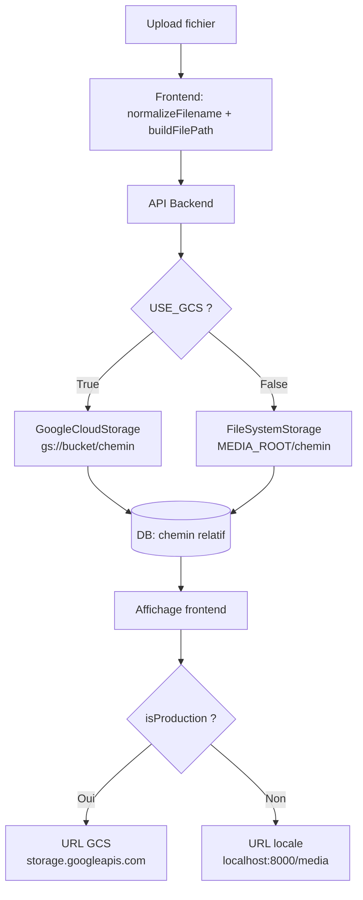

# Gestion des fichiers — stockage local vs Google Cloud Storage (GCS)

Ce document décrit la logique de gestion des fichiers média dans 360 Manager Plus : où sont stockés les fichiers, comment ils sont nommés, et comment les URLs sont construites côté backend et frontend.

## Vue d'ensemble

Le système repose sur **trois briques complémentaires** :

| Couche | Fichier | Rôle |
|--------|---------|------|
| Backend | `backend/app/metier/services/storage_service.py` | Écriture, lecture, suppression et génération d'URL selon `USE_GCS` |
| Frontend | `frontend/src/helpers/builders/file-name-builder.ts` | Normalisation et construction des chemins **avant** l'upload |
| Frontend | `frontend/src/helpers/builders/media-url-builder.ts` | Construction des URLs d'affichage/téléchargement **après** stockage |

```
┌─────────────────────────────────────────────────────────────────────────┐
│                         FLUX COMPLET                                    │
├─────────────────────────────────────────────────────────────────────────┤
│  1. Upload (frontend)                                                   │
│     normalizeFilename() / buildFilePath()                               │
│     → "store_logos/mon-logo-20240614-120000.png"                        │
│                                                                         │
│  2. Envoi API (multipart ou chunked upload)                             │
│     Le backend reçoit un chemin déjà normalisé                          │
│                                                                         │
│  3. Persistance (backend — StorageService)                              │
│     USE_GCS=True  → Google Cloud Storage (bucket GCS)                   │
│     USE_GCS=False → disque local (MEDIA_ROOT)                           │
│                                                                         │
│  4. Base de données                                                     │
│     Stocke le chemin relatif : "store_logos/mon-logo-....png"           │
│     (pas l'URL complète)                                                │
│                                                                         │
│  5. Affichage (frontend — buildMediaUrl)                                │
│     Production  → https://storage.googleapis.com/{bucket}/{chemin}      │
│     Développement → http://localhost:8000/media/{chemin}                │
└─────────────────────────────────────────────────────────────────────────┘
```

---

## Variable `USE_GCS` (backend)

### Définition

Dans `backend/config/settings.py` :

```python
USE_GCS = os.getenv("USE_GCS", "False") == "True"
GS_BUCKET_NAME = os.getenv("GS_BUCKET_NAME")
GS_PROJECT_ID = os.getenv("GS_PROJECT_ID")
```

La valeur par défaut est **`False`** (stockage local).

### Comportement

| `USE_GCS` | Backend utilisé | Emplacement physique |
|-----------|-----------------|----------------------|
| `False` | `FileSystemStorage` | `MEDIA_ROOT` (par défaut `backend/media/`) |
| `True` | `GoogleCloudStorage` | Bucket GCS (`GS_BUCKET_NAME`) |

Le `StorageService` lit cette variable au démarrage et initialise **un seul** backend pour toute l'application (pattern singleton via `get_storage_service()`).

### Politique en cas d'erreur

- **`USE_GCS=True` et configuration invalide** (bucket manquant, clé SA absente, etc.) : l'application **lève une exception** et refuse de démarrer. Il n'y a **pas** de repli silencieux vers le disque local.
- **`USE_GCS=False`** : utilisation du stockage local, avec création automatique du dossier `MEDIA_ROOT` si nécessaire.

Cette règle évite qu'un container de production écrive par erreur sur un disque éphémère alors que GCS était attendu.

---

## Variables d'environnement

### Backend (`.env`)

| Variable | Obligatoire si GCS | Description |
|----------|-------------------|-------------|
| `USE_GCS` | — | `True` ou `False` (défaut : `False`) |
| `GS_BUCKET_NAME` | Oui | Nom du bucket Google Cloud Storage |
| `GS_PROJECT_ID` | Oui | ID du projet GCP |
| `GCS_UPLOADER_SA` | Oui | Clé du service account GCP au format **JSON sur une seule ligne** |

Paramètres Django associés (définis dans `settings.py`, indépendamment de `USE_GCS`) :

| Setting | Valeur par défaut | Usage |
|---------|-------------------|-------|
| `MEDIA_ROOT` | `backend/media/` | Racine du stockage local |
| `MEDIA_URL` | `/media/` | Préfixe URL pour le stockage local |

En mode DEBUG, Django sert les fichiers locaux via :

```python
# backend/config/urls.py
urlpatterns += static(settings.MEDIA_URL, document_root=settings.MEDIA_ROOT)
```

### Frontend (`.env`)

| Variable | Description |
|----------|-------------|
| `VITE_GCS_BUCKET_NAME` | Nom du bucket GCS (obligatoire, lu par `frontend/src/config/config.ts`) |

Le frontend **ne lit pas** `USE_GCS`. Il déduit l'environnement via `NODE_ENV`, `staging`, ou le hostname (localhost vs autre) pour choisir entre URL GCS et URL locale.

---

## Backend — `StorageService`

Fichier : `backend/app/metier/services/storage_service.py`

### Initialisation

```python
from app.metier.services.storage_service import get_storage_service

storage = get_storage_service()
```

Au démarrage, le service :

1. Lit `USE_GCS` depuis les settings Django.
2. Si GCS : charge les credentials via `GCS_UPLOADER_SA`, instancie `GoogleCloudStorage` avec `default_acl=None` (bucket UBLA), `file_overwrite=False`, `location=''`.
3. Sinon : instancie `FileSystemStorage` pointant vers `MEDIA_ROOT`.

### API principale

| Méthode | Description |
|---------|-------------|
| `save(name, content)` | Enregistre un fichier ; `name` est le chemin relatif (ex. `digital_products/fichier.zip`) |
| `delete(name)` | Supprime un fichier s'il existe |
| `exists(name)` | Vérifie l'existence |
| `url(name)` | Retourne l'URL publique d'accès |
| `is_gcs_enabled` | Propriété booléenne |
| `get_storage_info()` | Résumé de la configuration active |

### Génération d'URL (`url()`)

**Mode GCS** (`USE_GCS=True`) :

```
https://storage.googleapis.com/{GS_BUCKET_NAME}/{chemin_relatif}
```

**Mode local** (`USE_GCS=False`) :

```
/media/{chemin_relatif}
```

Si le chemin commence déjà par `/media/`, il est retourné tel quel.

### Normalisation des noms

La normalisation des noms de fichiers a été **déplacée côté frontend**. Le backend reçoit et persiste des chemins déjà normalisés.

### Consommateurs typiques

- `product_viewset.py` — fichiers digitaux (`digital_products/…`)
- `chunked_upload_viewset.py` — uploads volumineux par morceaux
- `prepared_viewset.py` — PDFs de préparation
- `snep_period_summary_service.py`, `snep_sftp_delivery_service.py` — exports SNEP (`snep_exports/…`)

---

## Frontend — normalisation des noms (`file-name-builder.ts`)

Fichier : `frontend/src/helpers/builders/file-name-builder.ts`

Toute normalisation se fait **avant** l'envoi au backend.

### `normalizeFilename(filename, addTimestamp?)`

Transformations appliquées :

1. Suppression des accents (Unicode NFD)
2. Conversion en minuscules
3. Remplacement des caractères spéciaux par des tirets (`-`)
4. Fusion des tirets multiples, suppression des tirets en début/fin
5. Optionnel : ajout d'un timestamp (`YYYYMMDD-HHMMSS`) pour garantir l'unicité
6. Troncature à 100 caractères (117 avec timestamp)

Exemples :

```
"Mon Fichier (2024).pdf"     → "mon-fichier-2024.pdf"
"Café & Thé.zip" (+ timestamp) → "cafe-et-the-20240614-120000.zip"
```

### `generateUniqueFilename(filename)`

Raccourci : `normalizeFilename(filename, true)`.

### `buildFilePath(folder, filename, addTimestamp?)`

Construit le chemin complet avec préfixe de dossier :

```typescript
buildFilePath("store_logos", "Mon Logo.png", true)
// → "store_logos/mon-logo-20240614-120000.png"
```

### Dossiers courants

| Préfixe | Usage |
|---------|-------|
| `store_logos/` | Logos de boutiques |
| `digital_products/` | Fichiers digitaux produits |
| `snep_exports/` | Exports SNEP (CSV, XML) |
| *(autres)* | PDFs préparation, factures comptabilité, etc. |

---

## Frontend — construction des URLs (`media-url-builder.ts`)

Fichier : `frontend/src/helpers/builders/media-url-builder.ts`

### `buildMediaUrl(filePath)` — fonction principale

Point d'entrée pour afficher ou télécharger un fichier. Logique :

1. **URL déjà complète** (`http://` ou `https://`) → retournée telle quelle
2. **Chemin `/media/...`** → préfixée par `http://localhost:8000`
3. **Autre chemin absolu** (`/…`) → retourné tel quel
4. **Production** (voir critères ci-dessous) → URL GCS :
   ```
   https://storage.googleapis.com/{VITE_GCS_BUCKET_NAME}/{filePath}
   ```
5. **Développement** → URL locale :
   ```
   http://localhost:8000/media/{filePath}
   ```

### Détection « production » (`isProduction()`)

Le frontend considère qu'il est en production si **l'une** de ces conditions est vraie :

- `NODE_ENV === "production"`
- `NODE_ENV === "staging"`
- Le hostname n'est ni `localhost` ni `127.0.0.1`

> **Important** : cette logique est **indépendante** de `USE_GCS` côté backend. En staging/production, le frontend construit des URLs GCS même si le backend local de test tourne avec `USE_GCS=False`. Les chemins en base restent identiques ; seule la résolution d'URL change.

### Fonctions utilitaires

| Fonction | Rôle |
|----------|------|
| `buildGcsUrl(filePath)` | Force une URL GCS (ignore l'environnement) |
| `buildLocalUrl(filePath)` | Force une URL locale |
| `isGcsUrl(url)` | Détecte une URL Google Storage |
| `isLocalUrl(url)` | Détecte une URL locale /media |
| `extractFilePathFromUrl(url)` | Extrait le chemin relatif depuis une URL GCS ou locale |
| `gcsToLocalUrl(gcsUrl)` | Convertit GCS → local (utile en dev) |
| `localToGcsUrl(localUrl)` | Convertit local → GCS |
| `getAppropriateUrl(filePath)` | Alias intelligent selon le type d'entrée |

---

## Convention de stockage en base de données

Les champs `FileField` / `CharField` média stockent le **chemin relatif** dans le bucket ou `MEDIA_ROOT`, sans préfixe `/media/` :

```
store_logos/mon-logo-20240614-120000.png
digital_products/album-flac.zip
snep_exports/Galery_19122025.csv
```

Ce format est **identique** en local et en GCS. Seule la résolution d'URL diffère selon l'environnement.

---

## Configurations types

### Développement local

**Backend** (`backend/.env`) :

```env
USE_GCS=False
```

**Frontend** (`frontend/.env`) :

```env
VITE_GCS_BUCKET_NAME=mon-bucket-dev   # requis par config.ts, même en local
VITE_API_URL_V1_LOCAL=http://localhost:8000/api/v1
```

Résultat :

- Fichiers écrits dans `backend/media/{chemin}`
- URLs frontend : `http://localhost:8000/media/{chemin}`
- Fichiers servis par Django en mode DEBUG

### Production / staging

**Backend** :

```env
USE_GCS=True
GS_BUCKET_NAME=mon-bucket-prod
GS_PROJECT_ID=mon-projet-gcp
GCS_UPLOADER_SA={"type":"service_account","project_id":"...","private_key":"...",...}
```

**Frontend** (variables de build) :

```env
VITE_GCS_BUCKET_NAME=mon-bucket-prod
VITE_NODE_ENV=production
```

Résultat :

- Fichiers écrits dans `gs://mon-bucket-prod/{chemin}`
- URLs frontend : `https://storage.googleapis.com/mon-bucket-prod/{chemin}`
- Le bucket doit être configuré en **UBLA** (Uniform Bucket-Level Access) ; les objets sont publics en lecture via IAM du bucket

---

## Diagramme de décision



---

## Points d'attention

1. **Cohérence bucket** : `GS_BUCKET_NAME` (backend) et `VITE_GCS_BUCKET_NAME` (frontend) doivent pointer vers le **même bucket** en production.

2. **Pas de fallback GCS → local** : si `USE_GCS=True` et la config est incorrecte, le backend ne démarre pas. Corriger les variables plutôt que de compter sur un repli disque.

3. **Normalisation uniquement frontend** : ne pas renommer côté backend ; le contrat est que le frontend envoie des noms déjà propres.

4. **URLs en réponse API** : le backend peut renvoyer une URL complète via `storage_service.url()`. Le frontend peut aussi reconstruire l'URL avec `buildMediaUrl(chemin_relatif)` à partir du chemin stocké en base — les deux approches coexistent.

5. **Chunks temporaires** : le `chunked_upload_viewset` utilise le `DEFAULT_FILE_STORAGE` Django pour les morceaux temporaires, puis le `StorageService` pour le fichier final. Les chunks intermédiaires ne suivent pas la même couche que le fichier définitif.

6. **Accès public GCS** : les URLs construites supposent que les objets sont lisibles publiquement (via IAM du bucket). Il n'y a pas de signed URLs dans le flux standard.

---

## Fichiers de référence

| Fichier | Description |
|---------|-------------|
| `backend/app/metier/services/storage_service.py` | Service central backend |
| `backend/config/settings.py` | Variables `USE_GCS`, `GS_*`, `MEDIA_*` |
| `frontend/src/helpers/builders/file-name-builder.ts` | Normalisation et chemins |
| `frontend/src/helpers/builders/media-url-builder.ts` | Construction des URLs |
| `frontend/src/config/config.ts` | Configuration `VITE_GCS_BUCKET_NAME` |
| `backend/.env.example` | Exemple de configuration locale |
| `00readme/README_SNEP_EXPORTS.md` | Cas d'usage exports SNEP (`snep_exports/`) |
