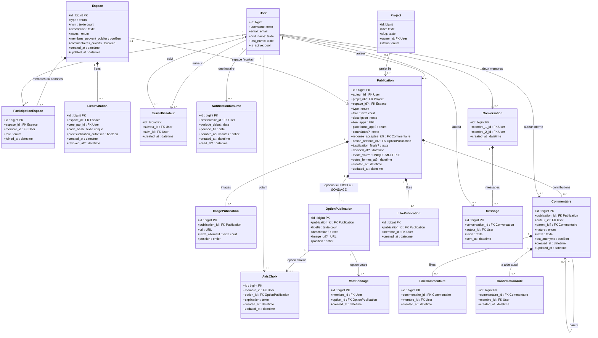

# Communauté — diagramme de classes proposé

Statut : **document de travail**, sans implémentation. Le diagramme modifiable est [MODELE_PROPOSE.drawio](MODELE_PROPOSE.drawio). Il contient une seule vue d'ensemble ; les espaces publics et accessibles par lien y sont représentés ensemble.

## Principe du modèle

- `Publication` couvre discussion, application partagée, entraide technique, aide au choix et sondage. Il n'y a pas de classe `Demande`, `ApplicationPartagee` ou `Sondage` distincte.
- `Commentaire` couvre commentaire ordinaire, retour sur une app et réponse technique. Une réponse à un commentaire utilise `parent`.
- `Espace` représente une **communauté** ou une **chaîne** grâce à un type fixe. Les deux espaces sont indépendants pour l'utilisateur. Une communauté règle qui peut publier ; dans une chaîne, seuls les administrateurs publient.
- `ParticipationEspace` représente le membre d'une communauté ou l'abonné d'une chaîne. Le créateur est super administrateur permanent ; d'autres administrateurs peuvent être nommés.
- `Conversation` et `Message` constituent une messagerie entre deux personnes, indépendante des publications et des espaces.
- `User` et `Project` sont des modèles existants, montrés comme références externes.

## Classes

| Ensemble | Classes du module | Rôle |
| --- | --- | --- |
| Publications | `Publication`, `ImagePublication`, `Commentaire`, `OptionPublication`, `AvisChoix`, `VoteSondage` | Contenu et contributions des cinq types de publications. |
| Réactions | `LikePublication`, `LikeCommentaire`, `ConfirmationAide` | Unicité du like ou de « Ça m'a aidé aussi » par membre et par cible. |
| Espaces | `Espace`, `ParticipationEspace`, `LienInvitation` | Communautés, chaînes, membres, rôles et liens d'accès. |
| Suivi | `SuiviUtilisateur`, `NotificationResume` | Abonnement libre à une personne et résumé quotidien dans l'application. |
| Privé | `Conversation`, `Message` | Échange direct entre deux membres. |

Le PRD fourni décrivait 13 classes propres au module. Cette proposition en compte **16** après les regroupements et l'ajout des nouveaux parcours. Le nombre de classes n'est pas une cible : les règles métier priment.

## Modèles existants réutilisés

| Modèle | Champs existants utiles ici | Décision |
| --- | --- | --- |
| `core.User` | `id`, `username`, `email`, `first_name`, `last_name`, `is_active` ; rôles et dates existent aussi. | **Aucune table User créée dans `communaute`**. Les relations pointent vers le compte existant. L'e-mail existe mais ne doit pas être exposé dans les profils Communauté publics. Aucun avatar n'existe actuellement dans ce modèle. |
| `devstreet_hub.Project` | `id`, `title`, `slug`, `owner_id`, `status`. | Projet existant, référence facultative depuis `Publication`. |

## Attributs proposés pour les 16 modèles de `communaute`

Les noms et types ci-dessous forment un **schéma de travail**, à valider avant migration. `?` signifie facultatif. `FK` désigne une référence vers un autre modèle ; `id` est la clé primaire.

| Modèle | Attributs | Contraintes ou sens |
| --- | --- | --- |
| `Espace` | `id: bigint PK`, `type: enum`, `nom: texte court`, `description: texte`, `acces: enum`, `membres_peuvent_publier: booléen`, `commentaires_ouverts: booléen`, `created_at: datetime`, `updated_at: datetime` | COMMUNAUTE ou CHAINE ; PUBLIC ou LIEN. Le créateur est la participation SUPER_ADMIN de cet espace. |
| `ParticipationEspace` | `id: bigint PK`, `espace_id: FK Espace`, `membre_id: FK User`, `role: enum`, `joined_at: datetime` | Unicité (espace_id, membre_id). Un seul SUPER_ADMIN par espace, permanent ; autres rôles ADMIN et MEMBRE. |
| `LienInvitation` | `id: bigint PK`, `espace_id: FK Espace`, `cree_par_id: FK User`, `code_hash: texte unique`, `previsualisation_autorisee: booléen`, `created_at: datetime`, `revoked_at?: datetime` | Le code brut du lien n'est pas conservé ; révocation possible. |
| `SuiviUtilisateur` | `id: bigint PK`, `suiveur_id: FK User`, `suivi_id: FK User`, `created_at: datetime` | Unicité (suiveur_id, suivi_id) ; pas de suivi de soi-même. |
| `NotificationResume` | `id: bigint PK`, `destinataire_id: FK User`, `periode_debut: date`, `periode_fin: date`, `nombre_nouveautes: entier`, `created_at: datetime`, `read_at?: datetime` | Un résumé par membre et journée couverte. |
| `Publication` | `id: bigint PK`, `auteur_id: FK User`, `projet_id?: FK Project`, `espace_id?: FK Espace`, `type: enum`, `titre: texte court`, `description: texte`, `lien_app?: URL`, `plateforme_app?: enum`, `contraintes?: texte`, `reponse_acceptee_id?: FK Commentaire`, `option_retenue_id?: FK OptionPublication`, `justification_finale?: texte`, `decided_at?: datetime`, `mode_vote?: UNIQUE/MULTIPLE`, `votes_fermes_at?: datetime`, `created_at: datetime`, `updated_at: datetime` | Cinq types ; les champs de vote concernent seulement le sondage. |
| `ImagePublication` | `id: bigint PK`, `publication_id: FK Publication`, `url: URL`, `texte_alternatif: texte court`, `position: entier` | Plusieurs images ordonnées par publication. |
| `Commentaire` | `id: bigint PK`, `publication_id: FK Publication`, `auteur_id: FK User`, `parent_id?: FK Commentaire`, `nature: enum`, `texte: texte`, `est_anonyme: booléen`, `created_at: datetime`, `updated_at: datetime` | COMMENTAIRE, RETOUR_APP ou REPONSE_TECHNIQUE. |
| `OptionPublication` | `id: bigint PK`, `publication_id: FK Publication`, `libelle: texte court`, `description?: texte`, `image_url?: URL`, `position: entier` | Au moins deux options pour CHOIX ou SONDAGE ; la description reste requise pour CHOIX. |
| `AvisChoix` | `id: bigint PK`, `membre_id: FK User`, `option_id: FK OptionPublication`, `explication: texte`, `created_at: datetime`, `updated_at: datetime` | La publication se déduit de l'option. Un seul avis par membre et publication CHOIX, contrôlé dans le service métier. |
| `VoteSondage` | `id: bigint PK`, `membre_id: FK User`, `option_id: FK OptionPublication`, `created_at: datetime` | La publication se déduit de l'option. Unicité (membre_id, option_id) ; le mode UNIQUE est contrôlé dans le service métier. |
| `LikePublication` | `id: bigint PK`, `publication_id: FK Publication`, `membre_id: FK User`, `created_at: datetime` | Unicité (publication_id, membre_id). |
| `LikeCommentaire` | `id: bigint PK`, `commentaire_id: FK Commentaire`, `membre_id: FK User`, `created_at: datetime` | Unicité (commentaire_id, membre_id). |
| `ConfirmationAide` | `id: bigint PK`, `commentaire_id: FK Commentaire`, `membre_id: FK User`, `created_at: datetime` | Unicité (commentaire_id, membre_id) ; cible de nature REPONSE_TECHNIQUE. |
| `Conversation` | `id: bigint PK`, `membre_1_id: FK User`, `membre_2_id: FK User`, `created_at: datetime` | Paire distincte et unique, quel que soit l'ordre. |
| `Message` | `id: bigint PK`, `conversation_id: FK Conversation`, `auteur_id: FK User`, `texte: texte`, `sent_at: datetime` | L'auteur doit être l'un des deux membres. |

## Diagramme complet

Le diagramme draw.io montre les mêmes attributs et relations dans une seule vue. Les boîtes grises `User` et `Project` sont des références existantes.

## Règles qui donnent du sens aux relations

- Une publication existe dans le fil général sans espace, ou dans **un seul espace** dans cette proposition. Le partage simultané dans plusieurs espaces reste à confirmer.
- Les liens directs conservés correspondent à des faits propres à leur table. Par exemple, l'auteur d'un message ne se déduit pas de sa conversation : il faut savoir lequel des deux membres l'a envoyé.
- `AvisChoix` et `VoteSondage` ne stockent pas de `publication_id` : `option_id → OptionPublication.publication_id` donne déjà la publication. Le diagramme ne répète pas de flèche directe vers `Publication`. En échange, la règle « un seul avis par membre et publication » et le vote UNIQUE doivent être vérifiés par le service métier dans une transaction ; une simple contrainte unique sur leurs colonnes ne suffit pas.
- `Espace` ne stocke pas de `createur_id` en double : son créateur est l'unique `ParticipationEspace` de rôle `SUPER_ADMIN`. Cette participation est créée avec l'espace et ne peut être supprimée ni rétrogradée.
- Le type de publication et le type d'espace restent fixes après création. Les champs propres à un type sont refusés pour les autres types.
- Une publication technique peut avoir une réponse acceptée : elle doit être un `Commentaire` de nature `REPONSE_TECHNIQUE` sur cette publication. Une publication de choix a au moins deux options ; l'option retenue et les avis portent sur cette même publication.
- Un sondage est une `Publication` de type SONDAGE, possible dans le fil général, une communauté ou une chaîne. Il a au moins deux `OptionPublication`. Son auteur choisit un vote UNIQUE ou MULTIPLE et peut voter selon les mêmes règles que les autres membres. Chaque `VoteSondage` désigne une option de ce sondage ; personne n'est obligé de voter. Les options sont figées dès le premier vote. Chacun peut modifier ou retirer son vote avant la fermeture. L'auteur peut fermer les votes ; le sondage et les résultats restent visibles. Avant fermeture, les résultats ne sont montrés qu'à un membre ayant encore un vote actif ; après fermeture, ils deviennent visibles à tous ceux qui peuvent lire le sondage. Les résultats publics ne présentent que des nombres, jamais l'identité des votants ; le système garde le membre en interne pour gérer l'unicité et la modification du vote.
- Un retour anonyme conserve son auteur côté serveur, mais les réponses API publiques ne révèlent pas son identité. Les commentaires enfants restent dans la même publication que leur parent.
- Les likes, confirmations d'aide et avis ont une unicité par membre et par cible. Un avis peut être modifié avant la décision finale de l'auteur.
- Dans une communauté, le créateur choisit l'accès public ou par lien et autorise tous les membres ou seulement les administrateurs à publier. Dans une chaîne, seuls les administrateurs publient ; les abonnés peuvent liker et les commentaires sont réglables.
- Le créateur d'un espace reste `SUPER_ADMIN` et ne peut être exclu ou rétrogradé. `ParticipationEspace` est unique pour un couple espace/membre, avec un seul `SUPER_ADMIN` par espace.
- Pour chaque `LienInvitation`, l'administrateur choisit si le détenteur peut lire avant de rejoindre. Le lien peut être révoqué ; la prévisualisation n'accorde aucun droit d'interaction.
- Suivre un membre est libre mais ne donne aucun droit de lecture supplémentaire. Le fil « Abonnements » et le résumé quotidien ne montrent que les publications accessibles, sans doublon.
- Une conversation lie deux membres distincts ; seul l'un d'eux peut lire et envoyer un message. Aucune relation avec `Publication` ou `Espace` n'est requise.

## Points à trancher avant le schéma final

- Pour le sondage : limites de longueur et de nombre d'options à préciser avant implémentation.

1. Une publication peut-elle être partagée dans plusieurs espaces ?
2. Qui peut nommer ou retirer les autres administrateurs et retirer un membre ? Le super administrateur peut-il transférer la propriété ?
3. Faut-il permettre à un utilisateur de bloquer un autre utilisateur ?
4. À quelle heure produire le résumé quotidien ?
5. Quel contrat doit relier les publications au `ProjectDiscussionLink` existant dans DevStreet Hub ?

Voir aussi [ETUDE.md](ETUDE.md) et [ESPACES_ET_ABONNEMENTS.md](ESPACES_ET_ABONNEMENTS.md).
